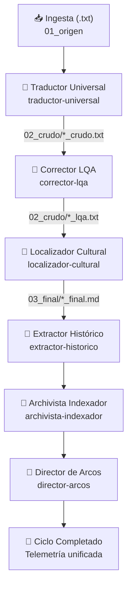

# 🌀 Orquestación y Flujos Lógicos de Agentes BATT (Flow)

Esta carpeta está destinada a alojar los esquemas de orquestación y diagramas de flujo que controlan la secuencia de transiciones del pipeline de traducción autónoma.

## Flujo de Orquestación Secuencial BATT

El procesamiento de un capítulo en disco duro desde su ingreso plano en `01_origen/` hasta su compilación literaria en `03_final/` sigue un flujo estructurado de **6 pasos secuenciales**, orquestado mediante el archivo `.config/agent_studio_flow.json`.

## Estructura Recomendada de un Flujo (Flow)

Cada definición de flujo orquestado se almacena como un archivo descriptivo o de configuración que contiene:
1. **Filtros de Entrada:** Qué condiciones disparan el flujo (ej. aparición de un archivo nuevo de capítulo).
2. **Secuencia de Procesamiento:** El orden de los agentes intervinientes.
3. **Mecanismo de Paso de Antorcha (State Passing):** Cómo se transfieren los resultados parciales entre agentes de forma segura.

---

## 🌀 Catálogo de Flujos de Orquestación Oficiales

Hemos diseñado y creado físicamente las plantillas lógicas para dos flujos de orquestación alternativos y optimizados de alta gama en esta carpeta:

### 1. Flujo Adaptativo Secuencial ([flow_adaptive_pipeline.json](file:///c:/wamp64/www/Applications/buca-studio/.agents/flow/flow_adaptive_pipeline.json))
*   **Mecánica**: El pipeline evalúa el tamaño y contenido del capítulo en local. Si es menor a 2,000 caracteres, rutea la llamada del corrector de estilo hacia un modelo rápido (`gemini-1.5-flash`). Si no se detectan personajes nuevos mediante pre-procesamiento local, omite quirúrgicamente el paso del `extractor-historico`. Asimismo, actualiza el panel global de control del `director-arcos` estrictamente cada 10 capítulos procesados.
*   **Ahorro Estimado**: **~45% - 60%** de tokens en capítulos de transición o cortos.

### 2. Flujo Cacheado por Lotes ([flow_cached_context.json](file:///c:/wamp64/www/Applications/buca-studio/.agents/flow/flow_cached_context.json))
*   **Mecánica**: Configura el pipeline secuencial en un modo por lotes que agrupa capítulos consecutivos y los envía aprovechando la infraestructura de **Context Caching de Gemini**. Las reglas de agentes y guías globales de traducción permanecen persistidas en el caché del API del modelo, cobrando una fracción mínima de token de entrada repetido.
*   **Ahorro Estimado**: **~50% - 80%** en procesamiento masivo de capítulos por lote.

---

## 🚦 Estado de los Archivos de Orquestación

*   **Flujo Base por Defecto**: [agent_studio_flow.json](file:///c:/wamp64/www/Applications/buca-studio/.config/agent_studio_flow.json) (Ubicado en la carpeta `.config/`).
*   **Flujos de Optimización Locales**: Almacenados en esta carpeta (`.agents/flow/`), listos para ser invocados de forma programática por el orquestador o la SPA web al cambiar el modo de traducción.

